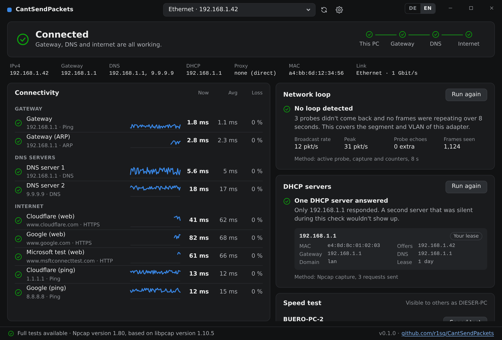
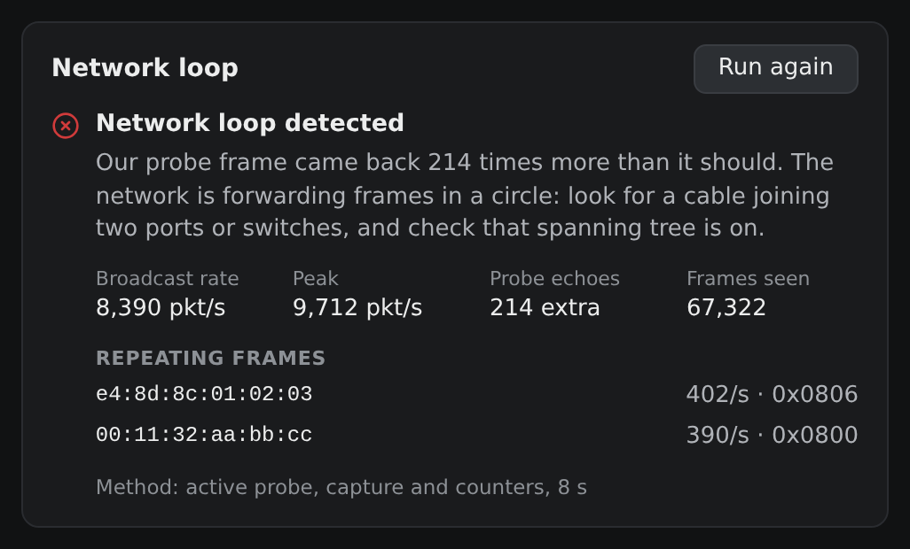
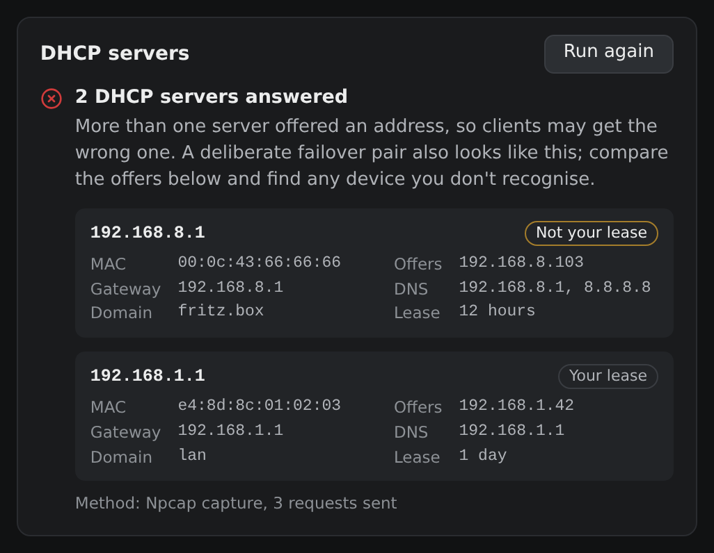

# CantSendPackets

**"What's wrong with this network?"**, answered by a small Windows app. Start it on the PC
with the problem and it tells you, in plain language, where the path breaks and what to look at.

## What it checks

- **Connectivity:** live latency and loss to the gateway, DNS, proxy and internet, and a verdict
  on where the path breaks.
- **Network loops:** broadcast storms and, with Npcap, frames that come back.
- **Rogue DHCP:** every DHCP server that answers, with any beyond your lease's own flagged.
- **Proxies:** found the way Windows finds them, tested through, and logged into.
- **Speed test:** copies on the same network find each other and measure the link between them,
  with no server to set up.

| A loop | A second DHCP server |
|---|---|
|  |  |

The interface is German by default ([screenshot](docs/screenshots/overview-de.png)), with English
one click away.

## Download

Get `CantSendPackets-windows-amd64.exe` (or `-arm64`) from the
[latest release](https://github.com/r1sq/CantSendPackets/releases/latest) and run it. There's no
installer and no admin rights needed. Keep it somewhere you can write to, such as Downloads, so it
can [update itself](docs/updates.md).

Windows 10 or 11 with WebView2 (included in Windows 11 and current Windows 10). The files aren't
code-signed, so SmartScreen warns on first start: *More info*, then *Run anyway*.

On Linux there's `cspcheck`, the same checks without a window, which also makes a good permanent
speed test endpoint: see [Linux](docs/linux.md).

[Npcap](https://npcap.com/#download) is optional and makes the loop and DHCP checks stronger.
Install it yourself; its licence doesn't allow bundling it.

## Learn more

- [How the checks work](docs/how-it-works.md): what each check does with and without Npcap, what
  it sends on the network, and what it can't see
- [Proxies](docs/proxies.md): detection, and when the Windows login is used
- [Speed test](docs/speed-test.md): discovery, firewall, and who can start a test
- [Updates](docs/updates.md): how releases are signed and checked
- [Linux](docs/linux.md): `cspcheck` on Linux, permissions, and a speed test endpoint as a service
- [Changelog](CHANGELOG.md)
- [Building and contributing](CONTRIBUTING.md)

## Licence

[GPL-3.0-or-later](LICENSE): use, change and share it freely. If you distribute a changed version,
publish its source under the same licence.
