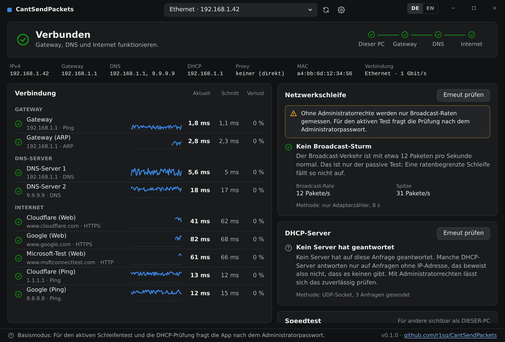

# Linux

The app runs on Linux too, with the same window, and so does `cspcheck`, the checks without a
window. Both find and speed test Windows copies and each other.

## The app

Download `CantSendPackets-linux-amd64` (or `-arm64`) from the
[latest release](https://github.com/r1sq/CantSendPackets/releases/latest), make it executable and
start it:

    chmod +x CantSendPackets-linux-amd64
    ./CantSendPackets-linux-amd64

It uses the system's GTK 3 and WebKitGTK 4.1, which current distributions have: Ubuntu 22.04 and
later, Debian 12 and later, Fedora. If they're missing:

    sudo apt install libgtk-3-0 libwebkit2gtk-4.1-0       # Debian, Ubuntu
    sudo dnf install gtk3 webkit2gtk4.1                   # Fedora

Keep it somewhere you can write to, such as `~/.local/bin`, so it can
[update itself](updates.md). For the application menu, save this as
`~/.local/share/applications/cantsendpackets.desktop`, with the path adjusted:

    [Desktop Entry]
    Type=Application
    Name=CantSendPackets
    Comment=Network diagnostics
    Exec=/home/you/.local/bin/CantSendPackets-linux-amd64
    Categories=Network;System;

### The password prompt

The loop test and the DHCP check need raw network access, which Linux only gives root. The window
itself doesn't run as root. Instead, when one of those two checks starts, the app asks
[polkit](https://www.freedesktop.org/wiki/Software/polkit/) (`pkexec`) to run that one check with
administrator rights, which shows the usual password prompt. Only that check runs as root, and
it exits when done.

If you cancel, or there's no polkit (as on a server without a desktop), the check runs without
the rights and says what it couldn't see: the loop check then measures broadcast rates only.

## cspcheck

Download `cspcheck-linux-amd64` (or `-arm64`, for a Raspberry Pi). It's one static file that
runs on any distribution, with or without a desktop.

    chmod +x cspcheck-linux-amd64
    ./cspcheck-linux-amd64                 # connectivity, loop and DHCP checks, as JSON
    ./cspcheck-linux-amd64 -checks loop    # one check
    ./cspcheck-linux-amd64 -serve 24h      # be a speed test endpoint for a day

### Permissions

Without the rights it needs, a check degrades and says why rather than report a false all-clear.

| | As a normal user | With root or the capabilities |
|---|---|---|
| Ping | Only if `net.ipv4.ping_group_range` includes your group (most desktop distributions); otherwise the ping targets are left out | Always |
| Loop check | Broadcast rate from the kernel's counters | Also probes and repeated frames, as with Npcap on Windows |
| DHCP check | Can't run: port 68 is reserved | Works, from `0.0.0.0` like a real client |
| Everything else | Works | Works |

Either run it with `sudo`, or give the file the two capabilities once:

    sudo setcap cap_net_raw,cap_net_bind_service+ep cspcheck-linux-amd64

### A permanent speed test endpoint

A server or a Raspberry Pi that's always on gives every copy something to test against. As a
systemd service:

    [Unit]
    Description=CantSendPackets speed test endpoint
    After=network-online.target
    Wants=network-online.target

    [Service]
    ExecStart=/usr/local/bin/cspcheck -serve 8760h
    DynamicUser=yes
    Restart=always

    [Install]
    WantedBy=multi-user.target

It needs no privileges for this. Open UDP and TCP 47116 in the firewall, and see
[Speed test](speed-test.md) for who can start a test.

## Differences from Windows

- **Proxies** come from `http_proxy`, `https_proxy` and `no_proxy`. PAC files and WPAD aren't
  evaluated, and a proxy login can only be typed, not taken from your account.
- **Broadcast counters** are the kernel's IP-level totals for all interfaces, so ARP isn't counted.
  Every loop also multiplies IP broadcasts, so it still shows.
- **The DHCP server** of the current lease is read from systemd-networkd, NetworkManager or
  dhclient. With another DHCP client the app knows the address is leased, but not from which server.
- **One window per user:** starting the app again brings the open window forward, through the
  session's D-Bus.
