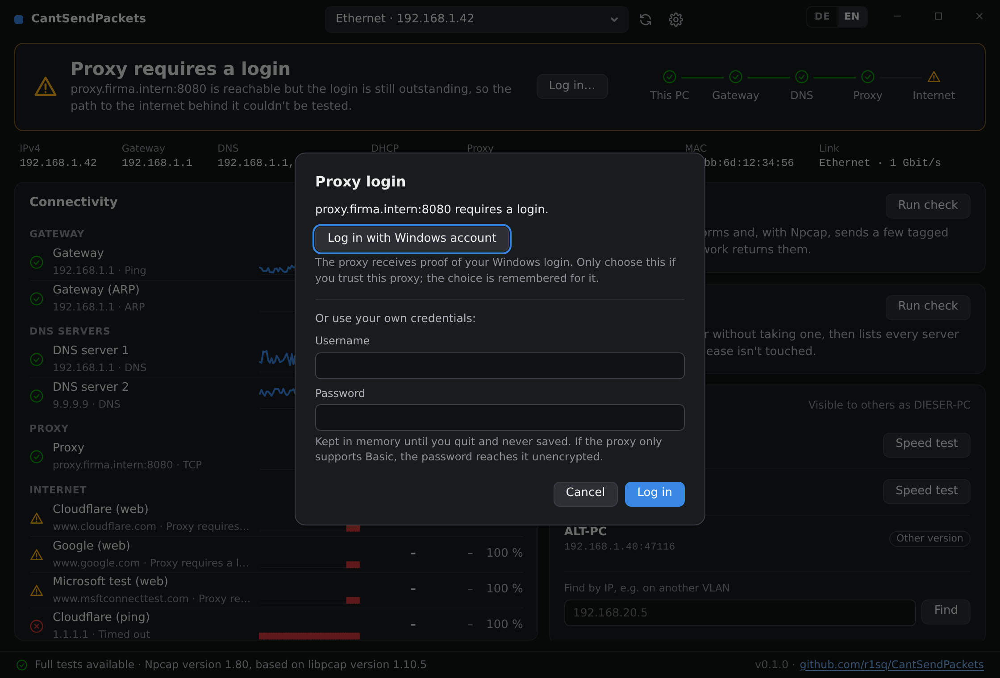

# Proxies

## Detection

Proxy settings are detected through WinHTTP in the order Windows and browsers use:

1. WPAD (DHCP option 252, then DNS), if automatic detection is on
2. The configured PAC file
3. The manual proxy
4. The machine-wide WinHTTP proxy (`netsh winhttp`)
5. If nothing is configured, WPAD anyway, labelled as off in Windows

The internet tests go through the proxy found. A PAC file that can't be used is reported, because
the machine is then not using the proxy its admin intended.

Detection re-runs when the adapter changes or from the refresh button. Settings can replace it for
this app's tests with no proxy, a fixed proxy, or a PAC file. Other programs aren't affected. SOCKS
proxies aren't supported.

## Logins

A proxy that asks for a login is answered through WinHTTP, with the Windows login where that's
appropriate. An NTLM answer can be cracked offline, and getting one is the point of a rogue WPAD
server, so how far a proxy is trusted depends on how it was found:

| Proxy came from | Windows login |
|---|---|
| Manual, PAC, `netsh winhttp`, or this app's settings | Used automatically |
| WPAD, with automatic detection on in Windows | Windows' intranet-only default; asks if that declines |
| WPAD, with automatic detection off | Not used unless you approve that proxy |

When a login is still needed, a button offers the Windows account (approval is remembered for that
proxy) or your own credentials. Typed passwords stay in memory until you quit and are never saved.
Windows logins only use Negotiate or NTLM. Typed credentials can also use Digest, or Basic if
that's all the proxy offers, which sends the password unencrypted.

Logged-in requests can't choose a source address, so they follow the routing table rather than the
selected adapter.
