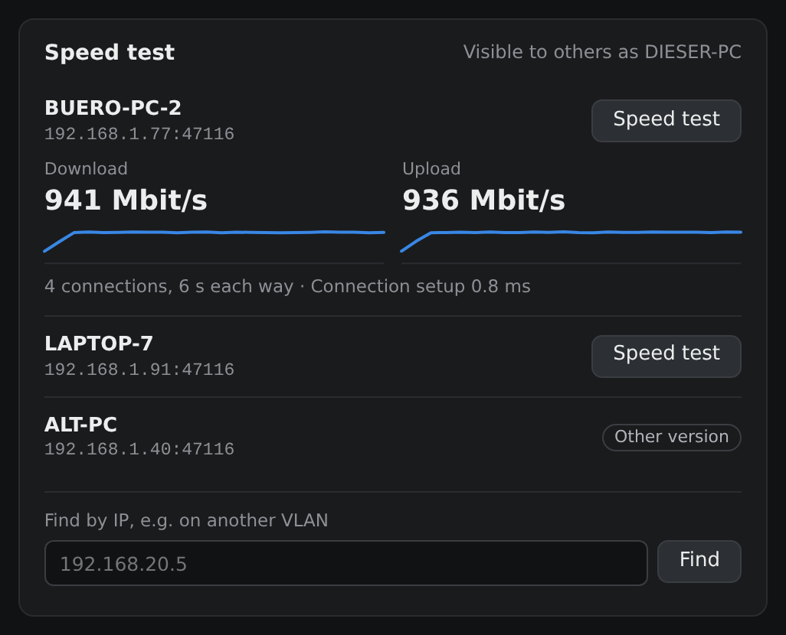

# Speed test

Every running copy announces itself and runs a test endpoint, so any copy can measure the link to
any other. Copies on the same PC, such as another user's session, aren't listed: that test would
never leave the machine.

There's no bundled iperf: ESnet publishes no Windows binaries, and third-party ones are Cygwin
builds. The test is a small native implementation with nothing extra to ship.

It runs 4 TCP connections for 6 seconds each way and leaves out the first second, so TCP slow start
doesn't skew the figure. Upload is measured at the receiving end. It saturates the link while it
runs, so other traffic will notice.

- **Discovery:** a hello on UDP 47116 every 5 seconds from physical adapters, carrying the PC name
  and test port, and answered directly. If broadcasts don't reach (another VLAN), search by IP.
- **Endpoint:** TCP 47116, or any free port if that's taken.
- **Firewall:** Windows asks on first start. Without that permission, other PCs can't find or test
  this one, but it can still find and test them.

## Who can start a test

Any device that can reach the port can start a test and make this PC send data, as there's no login
between copies. So the endpoint allows one test at a time, at most 30 seconds and 8 connections,
and only from private addresses or this PC's own subnets. The window shows when someone is testing.
Both the announcements and the endpoint can be turned off in Settings, which is worth doing on
networks you don't trust.
